# dev-almanac

<p align="center"><a href="./README.md">English</a> | <a href="./README.zh-CN.md">中文</a></p>

<p align="center"><strong>A programmer's almanac and daily horoscope for Claude Code.</strong></p>

<p align="center"><sub>Chinese almanac · daily horoscope · fortune slips · offline · deterministic · no tokens · never blocks your work</sub></p>

<p align="center">


<a href="./LICENSE"></a>
<a href="https://claude.com/product/claude-code" title="Claude Code"></a>
</p>

---

A traditional Chinese almanac tells you which activities suit each day and which to avoid. **dev-almanac** translates it for programmers. When the almanac favors a marriage, you merge branches today. When it warns against breaking ground, you leave the database schema alone.

The mod also gives a horoscope for the twelve signs, a fortune tube with 100 slips, and a small card above the prompt. Everything comes from the date. The mod makes no network or model calls and uses no tokens.

<p align="center">

</p>

| Part | What it shows |
| --- | --- |
| **Card above the prompt** | The lunar date, your sign's stars, and a ticker of today's do and don't lists, your lucky item and today's festival |
| **Status line** | One short entry, such as `🀄 Do: write docs ☿ retro` |
| **Almanac pane** (`/almanac`) | The full day: a seasonal postcard, the do and don't lists, the clash, the solar term, the twelve double-hours, the horoscope and the fortune tube |
| **Fortune slips** (`/qiuqian`) | One of 100 slips in seven grades, from Supreme to Dire, each with a two-line verse about code |

The mod shows Chinese by default. To show English, run `/almanac en` or press **🌐 English** in the pane.

## Quick start

1. At the prompt of a terminal session, type:

   ```
   /plugin install dev-almanac --marketplace BruceXcluding/dev-almanac
   ```

2. Type `y` to add the marketplace.
3. Select a scope. The mod is active at once.
4. Type `/almanac en` to open the almanac in English.
5. Type your birthday in the 🎂 field. This shows your sign and your Chinese zodiac animal.

From a shell, use this command:

```bash
claude plugin install dev-almanac --marketplace BruceXcluding/dev-almanac
```

The desktop app does not run `/plugin`. In the app, do these steps:

1. Click **+** next to the prompt box, then click **Plugins**.
2. Click **Add marketplace** and type `BruceXcluding/dev-almanac`.
3. Click **Add plugin**.

### dsh (DeepSeek Harness)

The repository also has a dsh version in [`packages/dsh`](packages/dsh/README.md). It adds an almanac tab to the right sidebar, the `/almanac` and `/qiuqian` commands, and an `almanac_today` tool for the agent. It uses the same almanac code as the Claude Code mod.

### Codex

The repository also has a Codex plugin in [`plugins/codex`](plugins/codex/README.md). It gives Codex four tools: `almanac_today`, `draw_fortune_slip`, `set_almanac_birthday` and `set_almanac_language`. To install it, run these commands:

```bash
codex plugin marketplace add BruceXcluding/dev-almanac
codex plugin add dev-almanac@dev-almanac
```

Then ask Codex "What does the almanac say about today?" or "Draw me a fortune slip".

## Commands

| Command | What it does |
| --- | --- |
| `/almanac` | Opens the almanac pane. `/huangli` does the same. |
| `/almanac en` | Shows the mod in English. `/almanac zh` shows it in Chinese. |
| `/almanac birthday 1997-06-01` | Sets your birthday. `/almanac birthday clear` removes it. |
| `/qiuqian` | Draws a fortune slip. `/fortune` does the same. Each draw gives a new slip. |

`huangli` is the Chinese word for the almanac, and `qiuqian` means "to draw a fortune slip".

## The almanac

The mod calculates the almanac for your local date. It shows:

- the lunar date, and the stem-and-branch names of the year, month and day
- the do and don't lists, each almanac term next to its meaning for a programmer
- the clash (the zodiac animal that conflicts with today) and the unlucky direction
- the solar term, and whether the day is auspicious or inauspicious
- the twelve double-hours, with the lucky ones marked

Some examples of the mapping:

| Almanac term | On the do list | On the don't list |
| --- | --- | --- |
| Breaking ground | Start a new project, `git init` | Change the database schema |
| Opening for business | Release, go live | Release on a Friday |
| Marriage | Merge branches | Merge a long-lived branch |
| Ancestral offering | Write docs | |
| Removal, house sweeping | Delete dead code, pay tech debt | |
| Travel, moving house | Deploy, migrate servers | Deploy to production |

Special days get their own line on the card and in the pane. These include the Lunar New Year, the Mid-Autumn Festival, 1024 Programmers' Day and the first day of each solar term. About once in each lunar month, a Great Fortune day shows a gold card and a toast.

## The horoscope

Each sign gets a new horoscope every day. The same date and sign always give the same result.

| Item | Example |
| --- | --- |
| Stars | Overall, coding, debugging and review, from 1 to 5 |
| Lucky color | Celadon blue · VS Code blue (the color also tints the card's border) |
| Lucky item | A rubber duck, a mechanical keyboard, an iced Americano |
| Lucky number | An HTTP status, a port or an exit code, such as `418 I'm a teapot` |
| Lucky language or tool | Rust, `git bisect`, `jq` |
| Lucky hour | One of today's lucky double-hours |
| Pair partner | The best sign for pair programming today |
| Helpful person, watch out for, advice | One line each |

During Mercury retrograde, debugging loses one star and the card shows a warning. If today's clash is your zodiac animal, the card also shows a warning.

## Fortune slips

<p align="center">

</p>

1. Open the almanac with `/almanac`.
2. Click **🎋 Shake · draw a slip**. The tube shakes and one slip comes out.
3. Read the slip: its grade, a two-line verse and its meaning.
4. If you do not like the slip, click **🎋 Shake again** to draw again.

There are 100 slips in seven grades: Supreme, Great, Good, Fair, Mixed, Poor and Dire. For the same birthday, the first draw of the day is the same on every machine. Each new draw gives a different slip.

## Settings

The birthday and the language are set in the pane, and the mod remembers them. You can also set defaults as plugin options:

| Option | Values | Default |
| --- | --- | --- |
| `birthday` | A date as `YYYY-MM-DD`. It gives your sign and your zodiac animal. | empty |
| `language` | `zh` (Chinese) or `en` (English) | `zh` |
| `level` | `lively`: card, status line, toasts and animations. `quiet`: status line only. `off`: commands only. | `lively` |

## Design principles

These rules decide how the mod works. Keep them when you change it.

1. **Never block work.** No hook stops, changes or delays a prompt or a tool call. If a part fails, the session continues without it.
2. **Offline and deterministic.** The output depends only on the date and your birthday. The mod makes no network or model calls.
3. **Keep the pairing visible.** The joke is the old term next to the modern task. Each row shows the almanac term on the left and its coding meaning on the right.
4. **One table for all mappings.** All mappings are in `hooks/almanac.ts`. Terms with the same meaning share a group, and a group shows as one row. Each list shows five rows. The other rows are under **+N more**.
5. **Colors follow the five elements.** The palette has 20 traditional Chinese colors, four for each element. The day's color comes from the element that generates the day's element, a traditional sign of luck. The pane shows the reason, such as "metal feeds water".
6. **No violet.** The design guidance keeps violet out of accents, because it is the usual color of generic generated interfaces. It also clashes with the warm colors of the almanac.
7. **Flat and readable.** The drawings use flat color, one corner-radius scale and text with a contrast of 4.5:1 or more. They follow [design-taste-frontend](https://github.com/Leonxlnx/taste-skill).
8. **Motion stops.** Each animation plays once and stops in about five seconds. With the system's reduced-motion setting, nothing moves and nothing is hidden.
9. **Settings where you use them.** You type your birthday in the horoscope box, not in a menu.
10. **For fun only.** The pane says so. Tests decide code quality, not fortune slips.

## Privacy

- **Local.** The mod reads the clock and its own saved settings. It sends nothing over the network.
- **Your birthday stays on your machine.** The mod keeps it in Claude Code's local plugin store.
- **No model calls.** The mod uses no tokens and needs no API key.

## How it works

```
the local date, your birthday
        │
hooks/almanac.ts    lunar-javascript → lunar date, stems and branches, do/don't groups, clash, solar term, hours, element
hooks/horoscope.ts  seeded by date and sign → stars, lucky color (five elements), item, number, hour
hooks/fortune.ts    seeded by date, birthday and draw count → one of 100 slips
hooks/flavor.ts     festival, solar-term and weekday lines
        │
hooks/day.ts        one Today value for every part
        │
hooks/register.tsx  card above the prompt · status line · almanac pane · /qiuqian
hooks/art.ts        the postcard and the fortune tube as SVG, and text frames for the terminal
```

## Develop

```bash
claude plugin validate .
claude plugin test .
node --test tests/dsh.test.mjs tests/codex.test.mjs
```

The tests cover known dates, the horoscope, the clash, Mercury retrograde, the slips and each part on every surface. The dsh and Codex tests need `node scripts/build-dsh.mjs` first.

## Glossary

The Chinese UI shows these terms. The English UI and this README use the English names.

| English | Chinese | Pinyin |
| --- | --- | --- |
| Chinese almanac | 黄历 | huánglì |
| Do / Don't | 宜 / 忌 | yí / jì |
| Clash | 冲 | chōng |
| Unlucky direction | 煞 | shà |
| Solar term | 节气 | jiéqì |
| Double-hour | 时辰 | shíchen |
| Stems and branches | 干支 | gānzhī |
| Auspicious / inauspicious day | 黄道日 / 黑道日 | huángdào rì / hēidào rì |
| Chinese zodiac animal | 生肖 | shēngxiào |
| Five elements | 五行 | wǔxíng |
| Day element | 纳音 | nàyīn |
| Fortune tube / fortune slip | 签筒 / 签 | qiāntǒng / qiān |
| Supreme … Dire (slip grades) | 上上签 … 下下签 | shàngshàng qiān … xiàxià qiān |
| Great Fortune day | 大吉 | dàjí |
| Mercury retrograde | 水逆 | shuǐnì |
| Breaking ground | 破土, 动土 | pòtǔ, dòngtǔ |
| Opening for business | 开市 | kāishì |
| Marriage | 嫁娶 | jiàqǔ |
| Ancestral offering | 祭祀 | jìsì |
| Removal, house sweeping | 解除, 扫舍 | jiěchú, sǎoshè |
| Travel, moving house | 出行, 移徙 | chūxíng, yíxǐ |

## Credits

- The almanac uses [lunar-javascript](https://github.com/6tail/lunar-javascript) 1.7.7 by 6tail (MIT). The library is in `hooks/vendor/` with its license.
- The Mercury retrograde dates come from the Farmers' Almanac tables.

## License

[MIT](./LICENSE)
